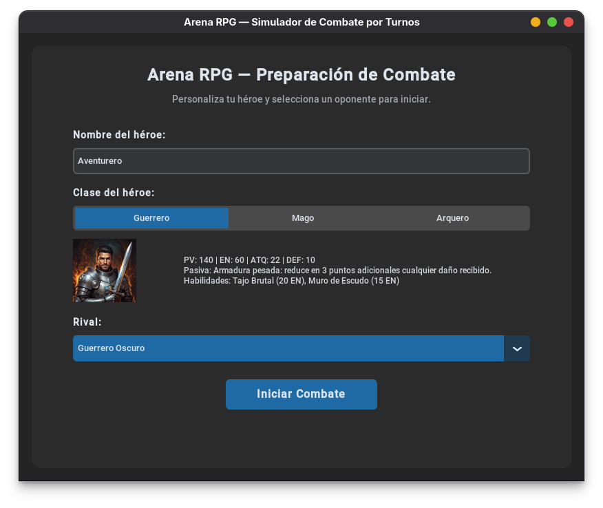
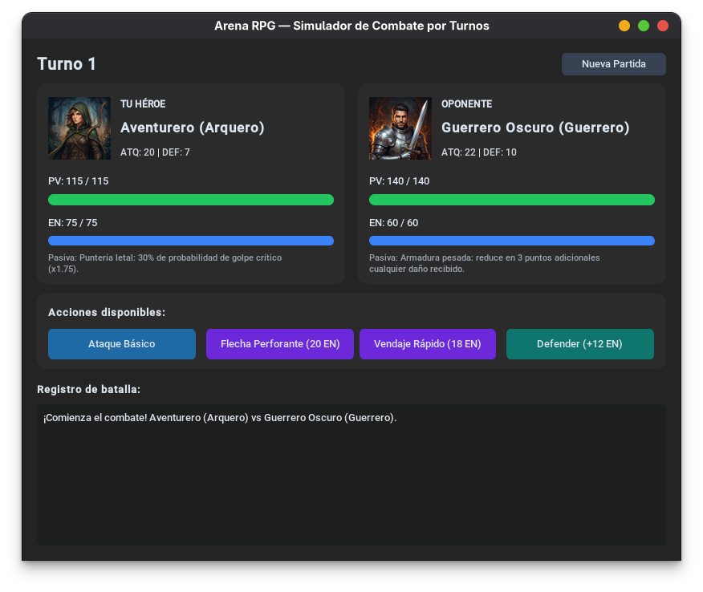

# Arena RPG — Simulador de Combate por Turnos

Aplicación de escritorio desarrollada en **Python** aplicando **Programación Orientada a Objetos (POO)** e interfaz gráfica moderna con **CustomTkinter**. Permite crear un héroe personalizado, elegir entre distintas clases con habilidades únicas y enfrentarse a oponentes controlados por una IA táctica en combates por turnos.

---

## 1. Descripción del problema

El aprendizaje de la Programación Orientada a Objetos suele quedarse en ejercicios de consola aislados donde resulta difícil visualizar cómo interactúan las clases, el encapsulamiento, la herencia, el polimorfismo y la abstracción en una aplicación real. Este proyecto surge para integrar todos esos conceptos en un simulador interactivo con interfaz gráfica, separando limpiamente la lógica de dominio de la capa visual.

---

## 2. Objetivos

- Aplicar los principios de la POO (abstracción, encapsulamiento, herencia, polimorfismo y composición) en un caso de uso coherente.
- Separar las responsabilidades del sistema en módulos de modelos, servicios, interfaz gráfica y pruebas.
- Implementar una interfaz gráfica intuitiva orientada a eventos que permita ejecutar todas las funcionalidades del simulador.
- Documentar el diseño, arquitectura y pruebas del software de manera profesional.

---

## 3. Funcionalidades

1. **Creación y personalización de combatientes:** Permite ingresar el nombre del héroe (con validación de entrada), elegir su clase (`Guerrero`, `Mago` o `Arquero`) visualizando sus estadísticas y pasiva en tiempo real, y seleccionar el oponente (`Guerrero Oscuro`, `Archimago del Caos`, `Cazador Sombrío` o `Señor de las Sombras (Jefe)`).
2. **Combate por turnos con habilidades especiales e IA:** El jugador puede realizar un ataque básico, activar habilidades únicas que consumen energía o adoptar una postura defensiva que mitiga el 50% del próximo daño recibido y regenera energía. El oponente responde automáticamente mediante una IA táctica.
3. **Seguimiento visual en tiempo real y reinicio:** Barras de vida y energía dinámicas, indicadores de estado (`En guardia`, `Derrotado`), registro detallado turno a turno, detección automática de victoria o derrota y opción de iniciar una nueva partida en cualquier momento.

---

## 4. Tecnologías utilizadas

- **Lenguaje:** Python 3.10+ (probado en Python 3.15.2 en Fedora Linux 45)
- **Interfaz gráfica:** `CustomTkinter` (sobre `Tkinter`)
- **Pruebas unitarias:** `unittest` (biblioteca estándar de Python) / compatible con `pytest`
- **Control de versiones:** Git y GitHub

---

## 5. Instalación

### Requisitos previos en Fedora Linux
En Fedora, `tkinter` se distribuye como paquete independiente del sistema. Instálalo con:

```bash
sudo dnf install python3-tkinter
```

### Clonar e instalar dependencias de Python

```bash
git clone https://github.com/Camilo045/parcial.git
cd parcial
python3 -m venv .venv
source .venv/bin/activate
pip install -r requirements.txt
```

---

## 6. Ejecución

Con el entorno virtual activado, ejecuta desde la raíz del proyecto:

```bash
python3 main.py
```

Para ejecutar las pruebas unitarias:

```bash
python3 -m unittest discover -s pruebas -v
```

---

## 7. Manual de usuario

1. **Pantalla de preparación:**
   - Escribe el nombre de tu héroe en el campo **Nombre del héroe**.
   - Selecciona una clase (`Guerrero`, `Mago` o `Arquero`) y revisa sus estadísticas base, pasiva y habilidades.
   - Elige un rival en el menú desplegable y presiona **Iniciar Combate**.

   

2. **Arena de combate:**
   - En la parte superior se muestra el número de turno y el botón **Nueva Partida**.
   - En el centro aparecen las tarjetas de tu héroe y del oponente con sus barras de Vida (`PV`) y Energía (`EN`).
   - En la parte inferior selecciona tu acción: **Ataque Básico**, cualquiera de tus **2 habilidades especiales** (si tienes energía suficiente) o **Defender (+12 EN)**.
   - Consulta el **Registro de batalla** para seguir el daño infligido, curaciones y golpes críticos.

   

---

## 8. Estructura del proyecto

```text
rpg-combate-poo/
├── main.py                         # Punto de entrada de la aplicación
├── requirements.txt                # Dependencias externas (CustomTkinter, pytest)
├── README.md                       # Documentación principal del repositorio
├── modelos/                        # Entidades de dominio y reglas de estado
│   ├── __init__.py
│   ├── habilidad.py                # Clase abstracta Habilidad y subclases polimórficas
│   └── personaje.py                # Clase abstracta Personaje y clases de combatientes
├── servicios/                      # Lógica de coordinación y creación de objetos
│   ├── __init__.py
│   ├── fabrica.py                  # Creación de héroes y rivales con sus habilidades
│   └── motor_combate.py            # Gestión de turnos, acciones e IA del rival
├── interfaz/                       # Capa de presentación gráfica (CustomTkinter)
│   ├── __init__.py
│   └── ventana_principal.py        # VentanaPrincipal y TarjetaCombatiente
├── pruebas/                        # Pruebas automatizadas
│   ├── __init__.py
│   └── test_combate.py             # Pruebas unitarias de POO, combate y errores
├── recursos/                       # Retratos PNG de cada clase de personaje
│   ├── arquero.png
│   ├── guerrero.png
│   ├── jefe.png
│   └── mago.png
└── docs/                           # Documentación técnica y evidencias
    ├── INFORME_TECNICO.md
    └── imagenes/
        ├── combate.png
        └── configuracion.png
```

---

## 9. Autor o autores

- **Estudiante:** Camilo (GitHub: [Camilo045](https://github.com/Camilo045))
- **Asignatura:** Programación Orientada a Objetos con Python
