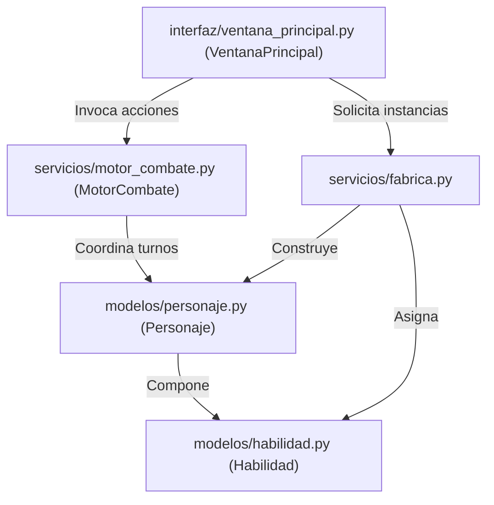

# Informe Técnico — Arena RPG (Simulador de Combate por Turnos)

## 1. Análisis del problema

### Necesidad identificada
Se requería diseñar y construir una aplicación de escritorio interactiva en Python que integrara de manera real los pilares de la Programación Orientada a Objetos (abstracción, encapsulamiento, herencia, polimorfismo y relaciones entre objetos) junto con una interfaz gráfica funcional.

### Público objetivo
Estudiantes, docentes y usuarios interesados en juegos de estrategia por turnos sencillos, así como desarrolladores que busquen una referencia clara de arquitectura modular en Python con separación entre dominio e interfaz.

### Funcionalidades y limitaciones
- **Funcionalidades:** Configuración de héroe y rival, combate por turnos con ataques básicos, habilidades especiales y defensa, IA táctica para el oponente, visualización en tiempo real y reinicio de partida.
- **Limitaciones:** El estado de las partidas se mantiene en memoria (no incluye guardado en base de datos ni modo multijugador en red), lo cual es coherente con el alcance definido para el parcial.

---

## 2. Diseño inicial

Al planificar el software se identificaron tres responsabilidades principales:
1. **Modelado de combatientes y habilidades (`modelos/`):** Definir qué es un personaje, qué invariantes deben proteger sus puntos de vida y energía, y cómo se comportan sus habilidades especiales.
2. **Coordinación del combate (`servicios/`):** Controlar la secuencia de turnos, validar que el combate siga activo y decidir las acciones del oponente.
3. **Interacción con el usuario (`interfaz/`):** Mostrar el estado actual del combate, capturar clics de botones y presentar mensajes claros ante errores o finalización de la partida.

---

## 3. Arquitectura

La aplicación sigue una arquitectura en capas inspirada en la separación de responsabilidades:



- **Regla clave de diseño:** La capa `interfaz/` nunca calcula daño, mitigación ni regeneración de energía; únicamente delega en `MotorCombate` y sincroniza los widgets con las propiedades públicas de los modelos.

---

## 4. Aplicación de POO

| Concepto | Clase o método | Archivo | Explicación |
| :--- | :--- | :--- | :--- |
| **Clases y objetos** | `Personaje`, `Habilidad`, `MotorCombate`, `VentanaPrincipal` | `modelos/`, `servicios/`, `interfaz/` | Cada clase encapsula una responsabilidad concreta del dominio o de la interfaz. |
| **Encapsulamiento** | `_vida_actual`, `_energia_actual`, `@property`, `recibir_danio()`, `consumir_energia()` | `modelos/personaje.py` | Protege la integridad del estado: la vida nunca baja de `0` ni supera `_vida_maxima`, y la energía nunca es negativa. |
| **Herencia** | `Guerrero`, `Mago`, `Arquero`, `EnemigoJefe` heredan de `Personaje`; `AtaquePotente`, `HechizoOfensivo`, `Curacion`, `PosturaDefensiva` heredan de `Habilidad` | `modelos/personaje.py`, `modelos/habilidad.py` | Reutilizan constructores mediante `super().__init__()` y especializan atributos y comportamiento de clase. |
| **Polimorfismo** | `calcular_ataque_basico()`, `recibir_danio()`, `ejecutar()` | `modelos/personaje.py`, `modelos/habilidad.py` | `MotorCombate` invoca `calcular_ataque_basico()` y `habilidad.ejecutar()` sin distinguir el tipo concreto; cada subclase responde distinto. |
| **Abstracción** | `Personaje(ABC)` y `Habilidad(ABC)` | `modelos/personaje.py`, `modelos/habilidad.py` | Definen contratos obligatorios mediante `@abstractmethod` (`calcular_ataque_basico`, `descripcion_pasiva`, `ejecutar`). |
| **Relaciones** | Composición (`Personaje` -> `_habilidades`) y Asociación (`VentanaPrincipal` -> `MotorCombate` -> `Personaje`) | `modelos/personaje.py`, `servicios/motor_combate.py` | Un personaje gestiona su lista de habilidades; el motor coordina a dos combatientes y la ventana se asocia al motor. |

### Ejemplo de encapsulamiento y validación (`modelos/personaje.py`)

```python
def recibir_danio(self, danio_bruto: int, ignorar_defensa: float = 0.0) -> int:
    if danio_bruto < 0:
        raise ValueError("El daño bruto no puede ser negativo.")
    if not self.esta_vivo:
        return 0
    defensa_efectiva = int(round(self._defensa * (1.0 - ignorar_defensa)))
    danio_mitigado = max(1, danio_bruto - defensa_efectiva)
    if self._defendiendo:
        danio_mitigado = max(1, danio_mitigado // 2)
        self._defendiendo = False
    self._vida_actual = max(0, self._vida_actual - danio_mitigado)
    return danio_mitigado
```

---

## 5. Construcción de la interfaz

- **Biblioteca seleccionada:** `CustomTkinter` por ofrecer una apariencia moderna en modo oscuro sobre `Tkinter` estándar sin requerir motores web pesados.
- **Controles implementados:** Campo de texto (`CTkEntry`), selector segmentado de clase (`CTkSegmentedButton`), menú de rivales (`CTkOptionMenu`), barras de progreso (`CTkProgressBar`), botones de acción (`CTkButton`) y registro de eventos (`CTkTextbox`).
- **Eventos y callbacks:** Cada botón enlaza un callback (`_on_iniciar_combate`, `_on_ataque_basico`, `_on_usar_habilidad`, `_on_defender`) que invoca al `MotorCombate` y actualiza la interfaz mediante `_sincronizar_vista()`.
- **Manejo de errores en GUI:** Si el usuario deja el nombre vacío o intenta ejecutar una acción inválida, la interfaz captura la excepción (`ValueError`, `RuntimeError`) y muestra un cuadro de diálogo informativo (`messagebox`) sin cerrar la aplicación.

---

## 6. Proceso de desarrollo

1. **Formulación de la idea:** Selección del simulador RPG por turnos como dominio ideal para demostrar herencia y polimorfismo.
2. **Identificación de funcionalidades:** Creación de héroe, combate por turnos con habilidades, IA rival y reinicio de partida.
3. **Diseño de clases:** Definición de las jerarquías `Personaje` y `Habilidad` y sus contratos abstractos.
4. **Construcción de la lógica:** Implementación de `modelos/` y `servicios/` independientes de la GUI.
5. **Desarrollo de la interfaz:** Construcción de `VentanaPrincipal` y el componente reutilizable `TarjetaCombatiente`.
6. **Integración y pruebas:** Creación de `pruebas/test_combate.py` con `unittest` para verificar invariantes, polimorfismo y errores.

---

## 7. Pruebas

Las 12 pruebas unitarias automatizadas en `pruebas/test_combate.py` se ejecutaron con éxito (`Ran 12 tests in 0.001s - OK`). A continuación se resumen tres casos representativos:

| Prueba | Acción realizada | Resultado esperado | Resultado obtenido |
| :--- | :--- | :--- | :--- |
| **Prueba 1 (Polimorfismo)** | Invocar `calcular_ataque_basico()` en `Mago` tras consumir energía y en `Arquero` con crítico garantizado. | `Mago` regenera `+6 EN` al atacar y `Arquero` multiplica el daño por `1.75`. | Exitoso: ambos retornan el daño y detalle esperado según su clase. |
| **Prueba 2 (Flujo completo)** | Ejecutar turnos en `MotorCombate` hasta derrotar al enemigo e intentar un turno adicional. | `combate_terminado` pasa a `True`, se asigna `ganador` y el turno extra lanza `RuntimeError`. | Exitoso: el combate finaliza correctamente y bloquea acciones posteriores. |
| **Prueba 3 (Error / Entrada inválida)** | Instanciar `Guerrero("   ")` e intentar `usar_habilidad()` con energía en `0`. | Se lanzan excepciones `ValueError` protegiendo el estado del objeto. | Exitoso: ambas validaciones lanzaron `ValueError` como se esperaba. |

---

## 8. Problemas y soluciones

1. **Ausencia de `tkinter` en la instalación base de Fedora Linux:**
   - *Diagnóstico:* Al validar el entorno en Fedora 45 con Python 3.15.2, la importación de `tkinter` arrojó `ModuleNotFoundError` porque en esta distribución se empaqueta por separado.
   - *Solución:* Se documentó en `README.md` la instalación del paquete del sistema (`sudo dnf install python3-tkinter`) antes de crear el entorno virtual e instalar `CustomTkinter`.
2. **Acoplamiento potencial entre reglas de combate e interfaz gráfica:**
   - *Diagnóstico:* Si las fórmulas de daño o la lógica de turnos vivían dentro de los callbacks de `CustomTkinter`, no sería posible probarlas automáticamente sin abrir ventanas gráficas.
   - *Solución:* Se desacopló completamente la lógica en `MotorCombate` y `modelos/`, permitiendo ejecutar todas las pruebas unitarias en consola en milisegundos.

---

## 9. Conclusiones

El desarrollo de **Arena RPG** permitió comprobar cómo los pilares de la Programación Orientada a Objetos simplifican la extensibilidad del software: agregar una nueva clase de héroe o una nueva habilidad solo requiere heredar de `Personaje` o `Habilidad` sin modificar el `MotorCombate`. Como mejoras futuras se podrían incorporar efectos de estado (veneno o aturdimiento), persistencia de estadísticas de victorias en JSON y sprites personalizados en la interfaz.
